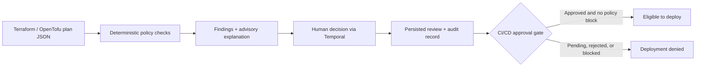

# PlanGate

PlanGate is a review and human-approval gate for Terraform and OpenTofu changes.
It reads a plan JSON file, checks for risky infrastructure changes, explains the
findings, and records a human decision before CI/CD can proceed.

For example, a plan that opens a security group to `0.0.0.0/0` is blocked by
policy—even if a human approves it. A plan that passes policy still waits for
human approval. PlanGate exposes the result as `can_deploy`, which a GitHub
Action checks before a deployment step.



Built as a local-first portfolio project with Python, FastAPI, Temporal,
PostgreSQL, Prometheus, and Docker Compose. SQLite is also supported. Explanations
are deterministic by default, with an optional local Ollama provider. No paid
model API or cloud account is required for the demo.

**Safety boundary:** Python policies enforce the rules; AI only explains their
findings; humans approve deployment. PlanGate never runs `terraform apply` or
`tofu apply`. The included workflows demonstrate the gate without deploying
infrastructure. A deployment workflow must explicitly require the gate to pass.

## Quick demo

Requirements: Docker with Compose, [Task](https://taskfile.dev/), `curl`, and `jq`.
Run these commands from the repository root. The checked-in fixture means you
can try PlanGate without installing Terraform or creating infrastructure.

### 1. Start the stack

Set a local development password in your shell, then start the services:

```bash
export PLANGATE_POSTGRES_PASSWORD='plangate-local-demo'
task dev:up
```

Compose starts the API, approval worker, Temporal, PostgreSQL, and Prometheus.
The API and worker both use PostgreSQL. Open the API docs at
[localhost:8000/docs](http://localhost:8000/docs) or the Temporal UI at
[localhost:8233](http://localhost:8233).

### 2. Submit a safe plan

```bash
review_id=$(jq '{plan: .}' tests/fixtures/plans/nginx-create.json |
  curl --fail-with-body -sS \
    -H 'Content-Type: application/json' \
    --data-binary @- http://127.0.0.1:8000/reviews |
  jq -er '.review_id')

curl --fail-with-body -sS "http://127.0.0.1:8000/reviews/$review_id" | jq
```

Expected fields: `decision: "approve"`, `approval_status: "pending"`, and
`can_deploy: false`. Passing policy does not replace human approval.

### 3. Approve and check the gate

```bash
curl --fail-with-body -sS \
  -H 'Content-Type: application/json' \
  --data '{"status":"approved","reviewer":"local-demo","reason":"Reviewed the safe Docker plan."}' \
  "http://127.0.0.1:8000/reviews/$review_id/approval"
```

The API returns `202 Accepted`; Temporal persists the decision asynchronously.
Run the following after a moment, repeating if it still shows `pending`:

```bash
curl --fail-with-body -sS "http://127.0.0.1:8000/reviews/$review_id" | jq
curl --fail-with-body -sS "http://127.0.0.1:8000/reviews/$review_id/approval" | jq
```

The review should now show `approval_status: "approved"` and `can_deploy: true`.
The second response is the audit record: reviewer, reason, decision, and timestamp.
Repeat with `tests/fixtures/plans/aws_sg_update.json` to see a policy block:
human approval will still leave `can_deploy: false`. This fixture is only JSON;
it does not create AWS resources.

### 4. Stop or start fresh

```bash
task dev:down       # Stop containers; preserve reviews and service data.
task dev:up         # Start again with the saved data.
task dev:teardown   # Stop containers and delete all Compose volumes.
```

Use the same PostgreSQL password when restarting an existing database volume.
Keep the password available in your shell for Compose commands, or put it in
an ignored `.env` file. Never commit real credentials.

## Policies

The enabled policies are configured in
[`config/policies.toml`](config/policies.toml).

| Policy ID | What it checks | Severity |
| --- | --- | --- |
| `public-inbound-access` | `0.0.0.0/0` ingress on `aws_security_group` create or update | high |
| `iam-wildcard-permission` | Wildcard action or resource in an allow statement on `aws_iam_policy` | high |
| `destructive-stateful-change` | Deletion of a `docker_volume` | high |
| `storage-encryption` | Missing or unknown encryption on `aws_ebs_volume` create or update | high or medium |
| `missing-required-tags` | Missing configured tags on `aws_ebs_volume` create or update | medium |

`enabled_policy_ids` selects trusted policy implementations. `required_tags`
controls the tag policy without changing Python code. Unknown policy IDs are
rejected during evaluation.

## Run locally

Requirements: Python 3.14+, [uv](https://docs.astral.sh/uv/),
[Task](https://taskfile.dev/), Docker, and
Terraform or OpenTofu for the optional local demo.

Install dependencies and run tests:

```bash
uv sync --dev
task test
```

For the full local stack, use the Docker Compose instructions below. To run
directly on your host, install the [Temporal CLI](https://docs.temporal.io/cli/setup-cli)
and start its development server first:

```bash
temporal server start-dev
```

In another terminal, start the worker from the repository root:

```bash
uv run python -m plangate.temporal.worker
```

Then start the API in a third terminal from the same directory:

```bash
uv run plangate
```

The API is available at `http://127.0.0.1:8000`. FastAPI also exposes
interactive documentation at `/docs`.

### Build the Docker image

With Docker running, build the image from the repository root:

```bash
docker build -t plangate .
```

The image contains the API and approval worker code. The API requires a
reachable Temporal server during startup, and a worker must run to persist
human decisions. Inside a container, the default `localhost:7233` points to
that container, so running the API image alone does not start the full system.
Use Docker Compose below to configure service networking and PostgreSQL
storage. Compose builds the image automatically, so the separate build above
is optional.

### Run with Docker Compose

From the repository root, set `PLANGATE_POSTGRES_PASSWORD` as in the quick demo,
then start the API, approval worker, Temporal development server, PostgreSQL,
and Prometheus together:

```bash
task dev:up
```

Stop any host API, Temporal server, and worker before starting Compose to avoid
port conflicts and having a host worker consume workflows intended for the
Compose worker. Published ports bind only to localhost:

- API documentation: `http://127.0.0.1:8000/docs`
- API metrics: `http://127.0.0.1:8000/metrics`
- Temporal UI: `http://localhost:8233`
- Temporal gRPC endpoint: `127.0.0.1:7233`
- Prometheus UI: `http://127.0.0.1:9090`

The API and worker connect to `temporal:7233` through the Compose network. Both
wait for Temporal and PostgreSQL healthchecks to pass before starting. They
connect to the database at `postgres:5432`. The Temporal entrypoint
fixes its data-directory ownership as root, then starts the development server
as the `temporal` user.

[`config/prometheus.yml`](config/prometheus.yml) configures Prometheus to scrape
`api:8000` every 15 seconds. The `api` hostname is the Compose service name;
Prometheus reaches it through the shared container network.

Open `http://127.0.0.1:9090/targets` and confirm the `plangate` target is
**UP**. Then create a review through the API, wait about 15 seconds, and execute
this query at `http://127.0.0.1:9090/query`:

```promql
plangate_reviews_total
```

The counter for the review's `policy_result` should increase by one. Before the
first successfully completed review, this query may return no data.

Compose uses four named volumes:

- `postgres-data` stores reviews and approval audit records in PostgreSQL.
- `temporal-data` stores Temporal workflow history.
- `prometheus-data` stores metric history.
- `plangate-data` is mounted at `/data` in the API and worker for SQLite mode;
  PostgreSQL mode stores reviews in `postgres-data` instead.

To verify approval processing after a worker restart:

1. Stop only the worker with `docker compose stop worker`.
2. Use the API examples below to create a new review and submit its approval.
   Expect `202 Accepted`; retrieving the review should still show `pending`.
3. Start the worker with `docker compose start worker`.
4. Retrieve the review again until it shows `approved`. Check
   `docker compose logs worker` for `Human decision persisted` with the matching
   `review_id`. A deterministic policy `block` must still keep `can_deploy` false.

Temporal retains the signal while the worker is stopped; the worker processes
it when it starts again.

The Prometheus configuration sets retention to one day (`1d`) and a size
threshold of `256MB`. Whichever limit triggers first determines removal of old
storage blocks. The size threshold is not a strict cap on total disk usage:
recent data, the write-ahead log, and temporary compaction files can require
additional space.

`task dev:down` stops and removes the containers and network while retaining
all named volumes. `task dev:teardown` also deletes every named volume.

To verify review persistence, create a review using the API example below and
save its `review_id`. Run `task dev:down`, then `task dev:up`
without removing the volumes. Fetch `GET /reviews/{review_id}` to confirm the
review is still available. Docker manages the volumes; on macOS with Docker
Desktop, they live inside Docker's Linux VM rather than in the repository.

### Host configuration

The API listens on `127.0.0.1:8000` by default. Set `PLANGATE_HOST`
to change the bind address, for example when running inside a container:

```bash
PLANGATE_HOST=0.0.0.0 uv run plangate
```

`0.0.0.0` listens on all IPv4 interfaces. Inside a container, this allows
connections through a published Docker port. The port remains fixed at `8000`.
Surrounding whitespace is trimmed; empty or whitespace-only host values are
rejected.

### Database configuration

Direct host execution defaults to SQLite; Docker Compose selects PostgreSQL.
The API and worker use the same store factory and must have matching database
settings so they can read and update the same reviews.

| Variable | Default | Purpose |
| --- | --- | --- |
| `PLANGATE_REVIEW_STORE_BACKEND` | `sqlite` | `sqlite` or `postgres` |
| `PLANGATE_SQLITE_DB_PATH` | `plangate.db` in the repository root | SQLite file path |
| `PLANGATE_POSTGRES_HOST` | `127.0.0.1` | PostgreSQL hostname; Compose uses `postgres` |
| `PLANGATE_POSTGRES_PORT` | `5432` | PostgreSQL port |
| `PLANGATE_POSTGRES_DB` | `plangate` | Database name |
| `PLANGATE_POSTGRES_USER` | `plangate` | Database user |
| `PLANGATE_POSTGRES_PASSWORD` | Unset | Required when PostgreSQL is selected |

For SQLite on the host:

```bash
PLANGATE_SQLITE_DB_PATH=/tmp/plangate.db uv run plangate
```

The SQLite parent directory must already exist and be writable. Relative paths
resolve from the working directory. Blank paths are rejected. Database files
matching `*.db` are ignored by Git.

Settings load an optional `.env` file from the working directory. PostgreSQL
credentials are passed to both application containers explicitly in Compose;
configuring the database service alone does not configure its clients.

### LLM provider configuration

`PLANGATE_LLM_PROVIDER` selects `deterministic` (the default) or `ollama`.
Configure the provider through these environment variables:

| Variable | Default | Purpose |
| --- | --- | --- |
| `PLANGATE_LLM_PROVIDER` | `deterministic` | Explanation provider: `deterministic` or `ollama` |
| `PLANGATE_LLM_MODEL` | `qwen3:4b` | Model used by Ollama |
| `PLANGATE_LLM_TIMEOUT` | `60` | Ollama HTTP request timeout in seconds; must be a positive integer |
| `PLANGATE_OLLAMA_URL` | `http://localhost:11434` | Ollama base URL; must use HTTP or HTTPS |

To use a locally running Ollama instance, start Ollama and ensure the configured
model is available, then run:

```bash
PLANGATE_LLM_PROVIDER=ollama \
PLANGATE_LLM_MODEL=qwen3:4b \
PLANGATE_LLM_TIMEOUT=60 \
PLANGATE_OLLAMA_URL=http://localhost:11434 \
uv run plangate
```

The model, timeout, and URL configure the Ollama provider; deterministic
explanations require no model service. If an Ollama request fails, the API logs
the error and falls back to a deterministic explanation of the same policy result.

Surrounding whitespace is trimmed from provider and model names; empty or
whitespace-only names are rejected. Invalid timeouts and URLs are rejected
when settings are loaded.

### Structured logging

The API writes JSON logs to stderr in the terminal. Each event includes a UTC
timestamp, log level, logger name, and message.

- `Review created` is emitted after the review is stored and its explanation
  succeeds. It includes `review_id`, `plan_hash`, and `policy_result`.
- `Human decision submitted` is emitted after the approval signal is accepted
  and the current review is retrieved. It includes the same review fields plus
  `requested_approval_status` (`approved` or `rejected`). This event does not
  confirm that the activity has persisted the decision.
- `Human decision persisted` is emitted by the worker after the activity saves
  the decision. It includes `review_id`, `approval_outcome`, and `workflow_id`.

Failed approval requests do not emit a successful human-decision event.

### Metrics

`GET /metrics` exposes metrics in Prometheus text format:

```bash
curl --fail-with-body -sS http://127.0.0.1:8000/metrics
```

| Metric | Type | Label | Values |
| --- | --- | --- | --- |
| `plangate_reviews_total` | Counter | `policy_result` | `approve`, `needs_review`, `block` |
| `plangate_policy_findings_total` | Counter | `policy_id`, `severity` | Policy IDs listed above; severity `low`, `medium`, or `high` |
| `plangate_approval_submissions_total` | Counter | `requested_status` | `approved`, `rejected` |
| `plangate_review_duration_seconds` | Histogram | `policy_result` | `approve`, `needs_review`, `block` |
| `plangate_explanation_duration_seconds` | Histogram | `provider_name` | `deterministic` or `ollama` |

The review counter increments after storage, explanation, and workflow startup
succeed. The approval-submission counter increments after Temporal accepts the
signal. It counts submissions, including later signals that the workflow may
ignore; it does not confirm persistence. Invalid inputs, unknown reviews, and
already finalized reviews do not increment it, nor do failed signal calls.
Policy results and approval submissions are counted separately; human approval
of a blocked review still does not allow deployment.

The policy-finding counter increments once per finding after review storage and
explanation succeed. Multiple findings in a review are counted separately,
including findings with the same policy ID and severity on different resources.
Reviews without findings and failed reviews do not increment it. Resource
addresses are kept out of metric labels.

Review duration measures elapsed time from the start of the review handler
through parsing, policy evaluation, storage, and explanation. Explanation
latency measures only the provider's `explain()` call. Both use a monotonic
clock and record successful operations only. If the configured explanation
provider fails, the API logs the error and uses a deterministic explanation
from the same policy result, then continues the approval workflow. The failed
provider call records no explanation duration; the successful fallback records
its own duration under `deterministic`, and the completed review records its
full duration. Histograms expose `_bucket`, `_count`, and `_sum` samples,
with durations measured in seconds. Provider labels use the provider's explicit,
stable `name`.

Each app instance owns its metrics registry. Metrics are held in memory and
reset when the app process restarts; they do not count historical database
records. A label combination appears after its first recorded event. Review
IDs and plan hashes stay in logs rather than metric labels.

## API

The API stores reviews and approval records in the configured PostgreSQL or
SQLite database. They survive application restarts when the database is
preserved. Recording a human decision updates the review and inserts its audit
record in one transaction; if either write fails, both are rolled back.

The `create_app()` factory retains an in-memory default for isolated tests;
the application entrypoint supplies the store selected by configuration.
Explanations are deterministic by default; no model API is required.

Run this example from the repository root with the API running. It uses Python
to wrap the checked-in local Docker fixture in the request body.

### Create a review

```bash
python3 -c 'import json; from pathlib import Path; print(json.dumps({"plan": json.loads(Path("tests/fixtures/plans/nginx-create.json").read_text())}))' | \
  curl --fail-with-body -sS http://127.0.0.1:8000/reviews \
    -H 'Content-Type: application/json' --data-binary @-
```

The response contains `review_id`, `decision`, `findings`, and `explanation`.
Copy the returned ID into a shell variable:

```bash
review_id='<returned review_id>'
```

### Retrieve the review

```bash
curl --fail-with-body -sS "http://127.0.0.1:8000/reviews/$review_id"
```

The response contains `review_id`, `plan_hash`, `decision`, `findings`,
`approval_status`, and `can_deploy`. A new review has `approval_status` set to
`"pending"` and `can_deploy` set to `false`. Retrieval does not regenerate or
return the explanation.

`can_deploy` is calculated from the current policy result and human decision:

| Policy decision | Human pending | Human approved | Human rejected |
| --- | --- | --- | --- |
| `approve` | `false` | `true` | `false` |
| `needs_review` | `false` | `true` | `false` |
| `block` | `false` | `false` | `false` |

Human approval is always required. A policy `block` keeps `can_deploy` false,
even after human approval. The GitHub Action described below checks this field
and fails its step unless deployment is allowed.

### Record a human decision

```bash
curl --fail-with-body -sS "http://127.0.0.1:8000/reviews/$review_id/approval" \
  -H 'Content-Type: application/json' \
  --data '{"status":"approved","reviewer":"Igor","reason":"Reviewed the local Docker changes."}'
```

Use `"rejected"` to reject the review. Reviewer and reason must be nonblank.
The endpoint returns `202 Accepted` with the current review snapshot. The
approval status may still be `pending`: accepting the signal does not wait for
the persistence activity. Retrieve the review again to observe the saved status
and recalculated `can_deploy` value. Persistence preserves the deterministic
policy decision and findings, even when a human approves a policy `"block"`.
This endpoint submits a decision; it does not deploy infrastructure. The
GitHub Action checks the persisted result through `GET /reviews/{review_id}`.

The Temporal server must be available when the API starts. The worker must be
running to execute approval activities. Docker Compose starts both services;
for direct host execution, use the separate-terminal instructions under
"Run locally". Configure the API and worker with the same
`PLANGATE_TEMPORAL_ADDRESS` (default `localhost:7233`) and database settings.
For SQLite, both processes must use the same `PLANGATE_SQLITE_DB_PATH`.

### Retrieve the audit record

```bash
curl --fail-with-body -sS "http://127.0.0.1:8000/reviews/$review_id/approval"
```

The response contains `review_id`, `status`, `reviewer`, `reason`, and
`decided_at`. The `decided_at` timestamp is the UTC time when the human decision
was submitted to the API, serialized as an ISO 8601 string. Retrieving the record preserves
the original timestamp.

Invalid plans or approval inputs return `422`. Unknown reviews return `404`;
retrieving an approval record before persistence completes also returns `404`
with `approval_not_found`. A decision submitted after the review is finalized
returns `409` with `review_not_pending`. While the review is still pending,
additional submissions can be accepted; the workflow keeps the first received
record and ignores later signals. Saving the exact same approval record again
is safe to retry; a different record cannot overwrite the persisted decision.

## GitHub Actions plan submission and approval gate

### Submit a plan

The composite action at
[`.github/actions/submit-plan/action.yml`](.github/actions/submit-plan/action.yml)
reads a plan JSON file, wraps it in the API request body, and calls
`POST /reviews` on an existing PlanGate instance.

| Input | Description |
| --- | --- |
| `api_url` | Required API base URL, including `http://` or `https://`, without a trailing slash |
| `plan_path` | Required path to a Terraform/OpenTofu plan JSON file, relative to the working directory or absolute |

| Output | Description |
| --- | --- |
| `review_id` | Created review's ID, used by the approval check |
| `plan_hash` | SHA-256 hash of the parsed plan serialized as canonical JSON by PlanGate |

Check out the repository before calling the local action. This example assumes
the API is running on the same runner, as in the integration workflow:

```yaml
steps:
  - uses: actions/checkout@v7
  - name: Submit plan for review
    id: review
    uses: ./.github/actions/submit-plan
    with:
      api_url: http://127.0.0.1:8000
      plan_path: tests/fixtures/plans/nginx-create.json
```

Later steps can read `${{ steps.review.outputs.review_id }}` and
`${{ steps.review.outputs.plan_hash }}`. The input must be JSON exported with
`terraform show -json` or `tofu show -json`, rather than a binary saved plan.
HTTP errors, invalid JSON responses, and missing or null output fields fail
the submission step. Submission creates a pending review; a human decision
must still be persisted before checking deployment eligibility.

### Check approval

The composite action at
[`.github/actions/check-approval/action.yml`](.github/actions/check-approval/action.yml)
calls `GET /reviews/{review_id}` on an existing PlanGate instance. It
succeeds only when the response contains the boolean `can_deploy: true`.
Pending approval, rejection, and a deterministic policy block fail the step.
Connection errors, HTTP errors, missing `can_deploy`, and invalid or empty JSON
responses also fail the step.

| Input | Description | Default |
| --- | --- | --- |
| `api_url` | API base URL, including `http://` or `https://`, without a trailing slash | `http://127.0.0.1:8000` |
| `review_id` | ID returned by `POST /reviews`; required | None |

The action checks once; it does not wait or poll for human approval. Run it
after the decision has been persisted. It does not create reviews, approve
plans, or run Terraform/OpenTofu. A deployment workflow must put its deployment
step after this check and let a failed check prevent deployment. Keep the saved
plan artifact and its returned review ID together throughout that workflow.

For a workflow in this repository, check out the repository before calling the
local action:

```yaml
steps:
  - uses: actions/checkout@v7
  - name: Check deployment approval
    uses: ./.github/actions/check-approval
    with:
      api_url: ${{ inputs.api_url }}
      review_id: ${{ inputs.review_id }}
```

This example assumes the calling workflow defines those two inputs. The
[demo workflow](.github/workflows/demo-approval-gate.yml) provides them through
`workflow_dispatch`. Once the workflow is available on the default branch,
open **Actions → Demo approval gate → Run workflow** and supply the API URL
and an existing review ID. It checks approval only; it has no deployment step.

The runner needs Bash, `curl`, `jq`, and network access to the API. The demo
uses `ubuntu-latest`: `127.0.0.1` there refers to the GitHub-hosted runner,
not your laptop. To check a company-hosted PlanGate instance, use an
API address reachable from the chosen runner. An API on a private network
requires a runner with access to that network. The action does not establish
network connectivity or configure API authentication.

### Plan review end-to-end tests

The [E2E workflow](.github/workflows/test-approval-action.yml), displayed
as **Plan review E2E**, runs on pull requests and through
`workflow_dispatch`. Its `plan-review-integration` job uses a three-case matrix:

| Case | Plan fixture | Expected gate outcome after simulated approval |
| --- | --- | --- |
| `safe-approved` | `nginx-create.json` | Success: deployment is eligible |
| `blocked-approved` | `aws_sg_update.json` | Failure: the policy block prevents deployment |
| `safe-rejected` | `nginx-create.json` | Failure: human rejection prevents deployment |

Each matrix case runs on a separate GitHub-hosted runner with its own Compose
stack, database, and volumes. The jobs can run in parallel subject to available
runner concurrency; `fail-fast: false` lets all cases finish if another fails.
Each case:

1. Starts the Docker Compose stack on the GitHub-hosted runner.
2. Waits for the local API to respond, retrying startup connection errors.
3. Calls `submit-plan` with its fixture and captures the returned review ID.
4. Calls the composite action while approval is pending and asserts that the
   action fails. An unexpected success fails the integration job.
5. Submits the simulated human decision configured for the case.
6. Polls until the worker has persisted the decision.
7. Calls `check-approval` again and compares its step outcome with the matrix's
   expected outcome. An expected policy denial passes the test; an unexpected
   gate result fails the job.

The workflow uses the runner's own API and database, needs no externally hosted
PlanGate instance, and does not deploy infrastructure.
Simulated approval belongs only to this test; normal
deployment reviews still require a human decision. The separate demo workflow
above checks an existing instance and review supplied by the caller.

To run the E2E tests manually, open **Actions → Plan review E2E →
Run workflow** and choose the branch to test. No API URL or review ID inputs
are needed.

For `main` protection, require both matrix checks from the
[tests workflow](.github/workflows/tests.yml) (`unit` and `integration`) and all
three **Plan review** E2E checks. Select their actual displayed names after the
workflows run. Pull-request triggers alone do not make checks mandatory.

## Local Terraform demo

[`terraform/local-demo`](terraform/local-demo) defines a Docker Nginx
container. It is intended only for local experimentation with a Docker daemon.

```bash
cd terraform/local-demo
terraform init
terraform plan -out=tfplan
terraform show -json tfplan > ../../tests/fixtures/plans/nginx-create.json
```

Do not commit Terraform/OpenTofu state, `.tfvars` files, binary plan files, or
credentials. If you apply the demo locally, destroy it when finished:

```bash
terraform destroy
```

## Tests and fixtures

| Suite | Command | Scope |
| --- | --- | --- |
| Unit | `task test:unit` | Tests outside `tests/integration` |
| Integration | `task test:integration` | Tests with real dependencies, including PostgreSQL and Temporal |
| All local tests | `task test` | Unit followed by integration tests |
| E2E | **Plan review E2E** GitHub workflow | Compose stack, plan submission, human decision, and CI gate |

Integration tests require Docker and `PLANGATE_POSTGRES_PASSWORD` in the shell
or an ignored `.env` file. The PostgreSQL fixture creates and drops a dedicated
`plangate_test` database. CI runs unit and integration tests in separate matrix
jobs and supplies a disposable database password.


Checked-in fixtures under `tests/fixtures/plans/` are fictional and safe to
commit. They cover both a local Docker plan and a risky public AWS security
group update. The tests cover parsing, individual policy checks, configuration
loading, decision rules, the domain pipeline, store isolation, SQLite
and PostgreSQL persistence and transaction rollback, the review and human-decision API routes,
JSON log formatting with and without review context, isolated metrics registries,
counter updates, policy-finding counts and failed-explanation exclusions,
duration histogram counts and sums, failure exclusions, and
the Prometheus endpoint.

Before committing changes:

```bash
task test
git diff --check
```

## Planned work

- Demonstrate the approval action before a deployment step in CI/CD.
- A bounded AWS demonstration with MFA, budget alerts, required tags, and a
  verified destroy path.
